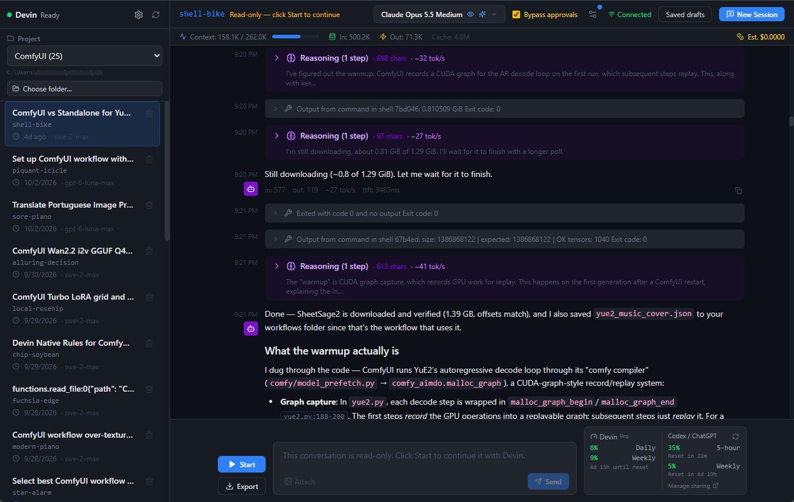

# Devin GUI

An unofficial, local browser interface for the [Devin CLI](https://docs.devin.ai/cli)
on Windows. Browse, resume, and export your Devin conversations by project.



Not affiliated with Cognition. Uses your own Devin CLI installation and account.

## Pros and cons vs. Devin Local

### Pros

- Lightweight browser UI; no Devin Desktop needed
- Markdown export with selectable reasoning, tool I/O, and summaries
- Estimated cost per conversation
- Unsent drafts survive reloads and browser restarts

### Cons

- No editor, terminal, or diff view
- No Devin Cloud integration
- No Quick Review
- No worktree management
- No Agent Command Center or Spaces
- No Plan/Ask mode selector
- No settings UI for MCP, skills, plugins, or sandbox (use CLI config)
- Tested on Windows only
- Manual setup; rerun after each update
- CLI updates can break history display

## Features

- **Project-scoped conversations**: pick a folder to see only its conversations.
- **Live streaming**: text, tool calls, reasoning, and token/context usage as they happen.
- **Permission prompts**: approve or reject tool calls in the browser, or opt into bypass mode.
- **Full history**: reasoning, tool calls, images, and compaction summaries, in order.
- **Non-destructive archiving**: hide conversations after exporting a copy; Devin's data is untouched.
- **Optional usage meters**: Devin quota and Codex/ChatGPT allowance (off by default).

## Requirements

- Windows (macOS, Linux, and WSL are untested)
- [Python 3.12+](https://www.python.org/downloads/windows/)
- [Node.js](https://nodejs.org/) 22.13+ (setup only)
- [Devin CLI](https://docs.devin.ai/cli), compatibility checked with **3000.11.92**
  (other versions show a warning; see [check scope](docs/setup.md#compatibility-with-devin-cli-updates))

## Quick start

1. Sign in and create Devin's history database. Send one message, then exit:

   ```powershell
   devin auth login
   devin
   ```

2. Clone or download this repository and open PowerShell in its folder.
3. Run setup. It creates `.venv`, installs dependencies, and builds the frontend.
   If PowerShell blocks the script, see [Setup options](docs/setup.md#setup-options).

   ```powershell
   .\setup-devingui.ps1
   ```

4. Run `start-devingui.bat` and open **http://127.0.0.1:8000**. Keep its window
   open; `Ctrl+C` stops the server.
5. Pick a project in the sidebar, then click **New Session**.

Rerun `setup-devingui.ps1` after each update.

## Usage notes

- Past conversations open read-only. Click **Start** to resume in the original folder.
- **Bypass approvals** turns off permission prompts for the *next* new session.
  Unanswered prompts expire and are rejected.
- The trash icon archives, never deletes. It saves an export to
  `Documents\Devin_Chat\<project>\<session-id>` and hides the conversation.
- Network drives, UNC paths, symlinks, junctions, and some OneDrive folders are
  rejected as projects.
- Drafts are stored per browser and address. Image attachments aren't saved.

## Security

- Binds to `127.0.0.1` only and rejects requests from other hosts and browser origins.
  There is no LAN or remote mode.
- Doesn't protect against other users or software on the same machine.

## Documentation

- [Setup and troubleshooting](docs/setup.md): setup options, diagnostics, configuration,
  data locations, optional integrations
- [Contributing](CONTRIBUTING.md): development server, tests, dependency locks

## License

[MIT](LICENSE). Devin, Codex, and other companion applications are distributed
separately under their own terms.
